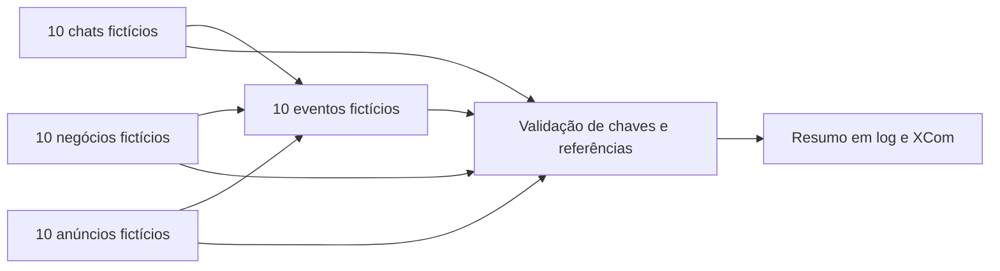

# Airflow — exemplo público sintético

[](https://github.com/gabrielassisp/Portfolio-Gabriel/actions/workflows/airflow-demo.yml)

Exemplo independente de TaskFlow para revisar dependências, XCom e propagação de falhas sem acessar sistemas reais. Não contém o código privado das cinco DAGs profissionais nem comprova seu funcionamento.



São seis tarefas e 40 registros pequenos. Dados passam por XCom apenas pelo tamanho didático; isso não é recomendação de transportar datasets grandes no metadatabase. A tarefa de publicação escreve um resumo no log/XCom, sem banco analítico. O DAG não chama APIs, PostgreSQL ou dbt e não implementa snapshot, CDC ou agendamento automático.

## Executar com Docker

No Bash/WSL, dentro de `airflow-demo`:

```bash
docker run --rm --entrypoint bash \
  -e AIRFLOW__CORE__LOAD_EXAMPLES=False \
  -e AIRFLOW__CORE__DAGS_FOLDER=/opt/airflow/portfolio-demo/dags \
  -v "$PWD:/opt/airflow/portfolio-demo:ro" \
  apache/airflow:2.9.2-python3.11 \
  -c 'airflow db migrate && python /opt/airflow/portfolio-demo/verify_demo.py'
```

O container é descartável, não publica portas, não precisa de credenciais e mantém o banco SQLite de teste somente durante essa execução. A CI usa o mesmo comando para importar o DAG com DagBag, verificar rejeição de duplicatas/referências órfãs e executar as seis tarefas com `dag.test()`.

`dag.test()` executa localmente no processo de teste; **não comprova scheduler, CeleryExecutor, retentativas em operação nem o projeto profissional**. O DAG tem disparo manual (`schedule=None`), `catchup=False`, uma execução ativa e uma retentativa configurada.

Implementação baseada na [API TaskFlow oficial do Airflow 2.9.2](https://airflow.apache.org/docs/apache-airflow/2.9.2/tutorial/taskflow.html).
