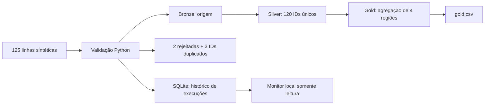

# Laboratório público de dados sintéticos

Exemplo executável criado para permitir a avaliação dos padrões apresentados no portfólio. É um laboratório independente, não uma cópia do sistema de produção. Usa somente Python 3.10+ e SQLite da biblioteca padrão: não exige credenciais, Docker, instalação de pacotes ou serviços em nuvem.

## Plataforma



Os valores são fictícios e determinísticos. Os nomes das tabelas ilustram as camadas; não significam que este exemplo roda o dbt de produção. A transformação do laboratório é Python/SQLite. O portfólio apresenta separadamente trechos dos modelos dbt reais.

Na raiz do repositório clonado:

```bash
cd lab
python run_demo.py
python -m unittest discover -s . -p "test_*.py" -v
python monitor.py
```

Abra `http://127.0.0.1:8088`. Em outro terminal, rode novamente `python run_demo.py` e atualize o histórico. Use `python3` se esse for o nome do Python na sua instalação. Para encerrar o monitor, pressione Ctrl+C.

Resultado esperado: 125 linhas de entrada, 120 IDs válidos, 2 registros rejeitados e 3 IDs duplicados. O tempo de execução é medido em cada máquina e não deve ser comparado ao tempo das cargas reais. Os arquivos são gravados em `lab/.demo-output/`, ignorada pelo Git. Não aponte `--output` para uma pasta de produção: o snapshot Bronze/Silver deste laboratório é substituído a cada execução.

## Monitor

`run_demo.py` persiste o início e o resultado de cada execução em SQLite. A carga é transacional e uma carga totalmente inválida preserva o snapshot anterior, registrando falha. `monitor.py` expõe apenas `GET /` e `GET /api/runs` em loopback. Não há disparo remoto de jobs, cancelamento ou fila neste laboratório; essas capacidades pertencem ao projeto privado apresentado no estudo de caso.

## Checklist documental

O arquivo `checklist.py` demonstra a pré-validação determinística de presença de documentos, com casos completos e pendentes. Não faz OCR, não usa IA, não substitui o workflow n8n de 96 nós e não contém documentos de clientes.

```bash
python checklist.py
```

## Limites e rastreabilidade

- Não usa APIs reais, dados anonimizados de clientes ou cópias de bancos internos.
- Não implementa Airflow, Prefect, Dagster, dbt ou serviços de nuvem.
- Execução manual local; o histórico permite inspecionar o resultado.
- Testes cobrem rejeição/deduplicação, repetição do snapshot, histórico e preservação após falha.
- O código completo do laboratório é público. As aplicações de produção continuam privadas; a demonstração pública não afirma reproduzir todas as suas capacidades.
