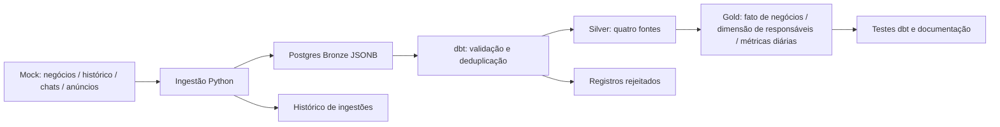

# Plataforma pública mínima — Python + Postgres + dbt

Laboratório independente com dados **100% fictícios**. Aproxima a demonstração da stack usada na plataforma privada sem copiar dados, regras de negócio, credenciais ou código interno. Não é uma reprodução completa do ambiente de produção.



## Executar

Requer Docker Engine/Desktop com Compose. Não precisa instalar Python, Postgres ou dbt no computador.

```bash
git clone https://github.com/gabrielassisp/Portfolio-Gabriel.git
cd Portfolio-Gabriel/platform-demo
docker compose run --build --rm pipeline
docker compose run --rm pipeline python verify_recovery.py
```

Os serviços usam a rede privada do projeto Compose `portfolio-platform-lab`; não publicam portas no host. O Postgres é exclusivo do laboratório, com volume próprio. As credenciais explícitas no Compose são exemplos locais descartáveis, não devem ser reutilizadas em produção. Uma thread dbt, limites de 256 MiB para Postgres e 512 MiB para o runner.

## O que observar

- 1.844 registros de entrada nas quatro fontes.
- 400 negócios, 800 eventos de histórico, 600 chats e 30 registros de anúncios após validação/deduplicação.
- Quatro registros rejeitados e dez versões duplicadas removidas; maior `version` ganha, com `seq` como desempate determinístico.
- Grão: uma linha por negócio em `gold.fct_deals`; uma por responsável em `gold.dim_owners`; uma por dia em `gold.daily_metrics`.
- Agregações de fontes antes dos joins evitam multiplicação de receita por chats ou histórico.
- Testes verificam unicidade, obrigatoriedade, relações, contagens do cenário e escolha da versão mais recente.

As fixtures possuem contrato controlado: datas ISO válidas, versões inteiras e tamanho limitado. A validação dbt exercita IDs, domínios, valores negativos e campos ausentes; não é um parser genérico para JSONs arbitrários de terceiros.

## Consultar

```bash
docker compose exec postgres psql -U demo -d portfolio_demo -c 'SELECT * FROM gold.daily_metrics ORDER BY business_date LIMIT 10'
docker compose exec postgres psql -U demo -d portfolio_demo -c 'SELECT run_id,status,input_rows,started_at,finished_at FROM ops.runs ORDER BY started_at DESC'
```

Cada carga gera `artifacts/<run_id>/run.json`, manifest, resultados dos testes, catálogo e página dbt. A duração é medida por execução; não é SLA nem benchmark de produção. Para abrir os documentos no computador, sirva a pasta `dbt-target` com um servidor HTTP local.

## Reexecução e falha

O snapshot Bronze é substituído em uma transação. A ingestão registra o início da execução em uma transação separada; uma falha faz rollback dos dados e persiste status `failed`. O script de recuperação repete a carga, compara conteúdo/contagem e injeta falha após 100 registros para comprovar a preservação do último snapshot.

`ops.runs` registra **ingestões**. O resultado de dbt e o status completo do pipeline estão nos artefatos; falha no dbt não muda retroativamente o status da ingestão. Não há transação global entre Bronze e todos os modelos dbt. O laboratório não implementa atualização incremental, CDC, SCD2, APIs externas, n8n ou Airflow.

## Encerrar

```bash
docker compose down
```

O volume mantém o histórico. Para apagar **somente os dados deste laboratório**, use `docker compose down -v` neste diretório. Os artefatos locais não são publicados automaticamente.

## Verificação automática

O workflow `Public Postgres dbt demo` executa a carga e a prova de recuperação em alterações deste diretório. Os resultados ficam como artefatos por sete dias. A documentação de execução validada está em `evidence.json` quando disponível.

## Execução validada

Em ambiente Docker/WSL local: **1.844 registros fictícios, nove modelos e 22 testes dbt aprovados**, em 26,751 segundos para ingestão, build, documentação e consulta. É uma execução específica, sem tempo de download/build da imagem. Consulte `evidence.json`.
